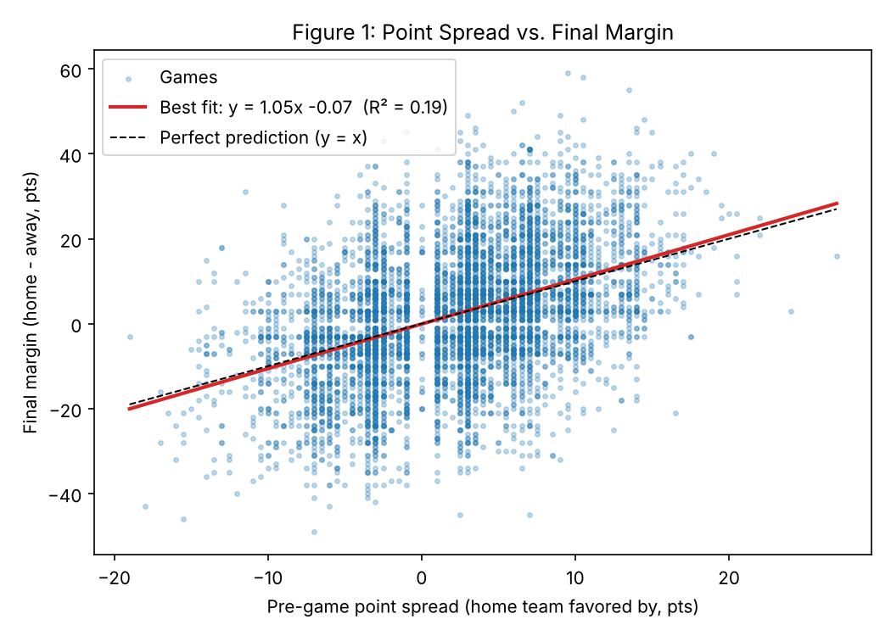
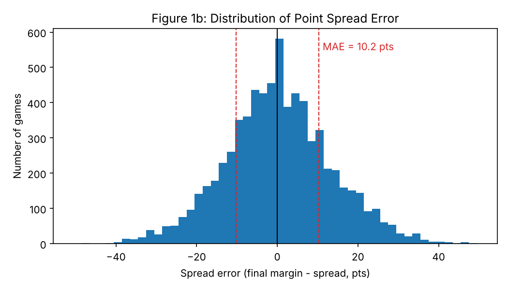

# Predicting NFL Outcomes Using Historical Statistics and Python

## Team Name and Contributors

Team: NEXTGEN ANALYTICS

Members: Dylan Bedois, Brian Chisholm

## Objective and Motivation

We are attempting to estimate the results and certain team-specific statistics of NFL games using past NFL data and observing patterns in game outcomes.

### Dataset

NFL games file (games.csv) from nflverse: https://github.com/nflverse/nfldata/blob/master/data/games.csv. The dataset contains every NFL game since 1999 with final scores, the point spread, home or neutral site, roof type, and temperature and wind at kickoff.

### Questions

**Q1: How accurately does the point spread predict the final margin?**
Expected answer: a best-fit line and the typical error in points.

**Q2: How big is home-field advantage, and has it changed over time?**
Expected answer: average home margin in points and whether it has shrunk.

**Q3: How do wind and temperature affect total points in outdoor games?**
Expected answer: points lost per mph of wind and per degree.

The benefit from these answers is the introduction of a baseline for predicting games and determination in which factors matter.

## Implementation Details

All questions use completed regular-season games only.

Python packages: pandas, NumPy, SciPy, Matplotlib.

### Q1: Point Spread Accuracy

- Method: linear regression of final margin vs point spread
- Metrics: slope, intercept, R^2, average error (pts), % of games the favorite won
- Plot: scatter plot of spread vs. final margin with best-fit line

### Q2: Home-Field Advantage

- Method: t-test of whether average home margin is greater than 0; t-test comparing 1999–2018 to 2019–present
- Metrics: average home margin, home win %, p-values
- Plot: bar chart of average home margin by season

### Q3: Weather and Scoring

- Method: regression of total points on wind and temperature (outdoor games only); t-test of windy (15+ mph) vs. calm games
- Metrics: points per mph of wind, points per degree, R², p-values
- Plot: bar chart of average total points by wind speed

## Results

### Q1: Point Spread Accuracy

Code: [`source/q1_point_spread.py`](source/q1_point_spread.py) (data loading and cleaning in [`source/load_data.py`](source/load_data.py)). Run it from the `source/` folder with `python q1_point_spread.py`.

Command-line output (also saved in [`output/q1_output.txt`](output/q1_output.txt)):

```
Question 1: How accurately does the point spread predict the final margin?
Method: least-squares linear fit  result = m * spread_line + b
------------------------------------------------------------------------
  Games analyzed            : 7102
  Seasons                   : 1999-2026
  Slope m                   : 1.051
  Intercept b               : -0.073 pts
  Correlation R             : 0.431
  R^2                       : 0.186
  p-value (slope)           : < 0.001
  Mean error (bias)         : 0.038 pts
  Mean absolute error       : 10.248 pts
  Median absolute error     : 8.000 pts
  Root-mean-square error    : 13.167 pts
  Favorite won outright     : 66.544 %
  Within 3 pts of spread    : 21.487 %
  Within 7 pts of spread    : 45.480 %
------------------------------------------------------------------------
Figures saved to figures/fig1_spread_vs_margin.png and figures/fig1b_spread_error_hist.png
```





Findings:

- **Best-fit line:** final margin = 1.05 × spread − 0.07. This is almost the same as a perfect prediction (y = x), and the average error is only +0.04 points, so the spread does not lean toward home or away teams.
- **Typical error:** the spread misses the final margin by 10.2 points on average (median 8 points, RMSE 13.2 points). Only 21.5% of games finish within 3 points of the spread and 45.5% within 7 points.
- **Strength of fit:** the slope is highly significant (p < 0.001), but R² = 0.186, so the spread explains only about 19% of the variation in final margins.
- **Favorites:** the favored team won outright in 66.5% of games.
- **Error distribution (Figure 1b):** centered on 0 and roughly bell-shaped, which confirms there is no systematic bias.

### Q2: Home-Field Advantage

To be completed.

### Q3: Weather and Scoring

To be completed.

## Conclusions

**Q1:** The point spread is an accurate predictor on average, since its best-fit line nearly matches y = x, but it is not precise for any single game, missing by about 10 points on a typical game. This gives us a baseline for predicting games: any model we build should be compared against the spread and would need an average error below about 10.2 points to beat it. Because the spread explains only about 19% of the variation in final margins, most of the outcome comes from factors the spread does not capture, which is what Q2 (home field) and Q3 (weather) will examine.

**Q2 and Q3:** To be completed.

## Actions That Need to Be Completed

- [x] Q1: code, command-line output, plots, results and conclusions
- [ ] Q2: run `source/q2_home_field.py`, add the output, plots, results and conclusions
- [ ] Q3: run `source/q3_weather.py`, add the output, plots, results and conclusions
- [ ] Final report and presentation

## References

- nflverse games.csv: https://github.com/nflverse/nfldata
- SciPy, pandas, NumPy, and Matplotlib documentation
